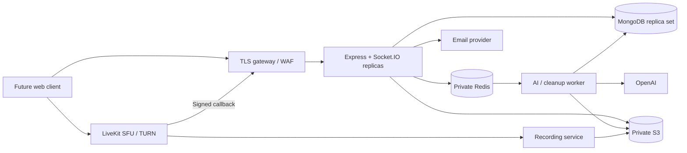

# Deployment and operations

## Local environment

`npm run setup` creates random ignored development secrets and generated media configuration. `docker compose up --build -d` runs API, worker, MongoDB replica set, Redis, private SeaweedFS and Mailpit. Add `--profile media` for LiveKit and Egress. AI requires your actual OpenAI API key; Google OAuth requires a registered client and exact callback `${API_URL}/api/auth/google/callback`.

Compose is a development configuration. MongoDB authentication is deliberately absent on its local loopback port; production must use a secured deployment. SeaweedFS credentials are local development credentials only; its internal management ports are not published. No volumes are deleted by setup. Do not use `docker compose down -v` when data must be retained.

Local recording uses a separate LiveKit Egress container with Chrome sandboxing enabled. Its documented `SYS_ADMIN` capability is isolated to that optional container, not granted to API or worker. Prefer managed LiveKit Cloud for production unless you have the operational experience to isolate, monitor and patch SFU/egress hosts. Test UDP, NAT and TURN from real remote networks. Docker Desktop container addresses are not a substitute for public media connectivity.

## Production topology

Deploy the same image with `node dist/server.js` and `node dist/worker.js` as separate services. Use managed MongoDB with replica-set transactions and durable Redis with TLS/authentication and `noeviction`. API instances share the Socket.IO Redis adapter. WebSocket-only transport removes polling sticky-session requirements; gateways still need correct upgrade support, timeouts and draining.

Production config must set `NODE_ENV=production`, HTTPS app/API/CORS origins, random `JWT_SECRET`, independent 64-hex-character `ENCRYPTION_KEY`, `METRICS_TOKEN`, SMTP, and `REQUIRE_ADMIN_MFA=true`. Start-up rejects missing baseline settings. Keep `LIVEKIT_URL` as the backend-reachable endpoint and `LIVEKIT_PUBLIC_URL` as the browser-reachable endpoint. Use `LIVEKIT_CLOUD=true` only for a compatible Cloud deployment. S3 `S3_ENDPOINT` is backend-reachable; `S3_PUBLIC_ENDPOINT` is the endpoint signed for clients. AWS can omit explicit S3 credentials and use workload identity; verify the separate recording service's upload identity as well.

`deploy/kubernetes.yaml` supplies application Deployments, Service, disruption budget, restricted pod security and default-deny network policies. It intentionally cannot run until an operator supplies the immutable release image, `intellmeet-env` Secret, TLS ingress and exact dependency egress policies. Generic public CIDR allowlists would defeat the network restriction. Use your CNI's FQDN rules or an egress proxy for provider APIs. The example ingress namespace selector must match your actual controller.

The image runs as UID 1000 with no application write requirement. Do not bake secrets into it. Pin promoted application/base/service image digests in your deployment repository and scan them before release. CI builds the image but does not deploy it or receive production credentials.

## Database and jobs

Unique indexes enforce email, workspace membership, participant identity, client message IDs, transcript asset IDs and accepted AI action IDs. The application currently creates indexes at startup; provision those through a migration account first if runtime credentials cannot create indexes. Never use destructive `syncIndexes` on production without reviewing its plan.

JobRecord is a durable outbox. If Redis enqueue fails, the worker dispatcher resubmits queued records. BullMQ uses stable job IDs, four attempts and exponential backoff. Handlers are retry-safe at persistence boundaries. Redis AOF/managed persistence and backups are still needed: Mongo outbox recovery does not recreate every Redis in-progress attempt after catastrophic Redis data loss. For disaster recovery, inspect stranded `running`/`failed` records against BullMQ and retry only after ensuring no worker owns the operation. API `POST /jobs/:jobId/retry` creates a new authorized attempt for a failed record.

Recording callbacks are authenticated and deduplicated. Every 30 seconds the worker checks outstanding recordings, recovers a uniquely identifiable egress after an ambiguous start response, and finalizes known finished egresses. If multiple ambiguous egresses exist, inspect them operationally instead of starting another recording. Provider callbacks may be delayed or lost; monitor records stuck in `starting`/`stopping`.

## Metrics and alerts

- `/health/live`: process liveness.
- `/health/ready`: MongoDB and Redis readiness.
- `/metrics`: requires `Authorization: Bearer <METRICS_TOKEN>`; keep private.
- Prometheus counters/histograms: `intellmeet_http_requests_total`, `intellmeet_http_duration_seconds`, plus Node process metrics.
- Worker writes `intellmeet:worker:heartbeat` in Redis with a 120-second expiry. Alert if missing. Compose checks it; wire equivalent monitoring into production.
- Alert on API errors/latency, database and Redis availability, missing worker heartbeat, failed/stalled jobs, recording finalization delay, queue depth, SFU packet loss, storage errors, and provider spend.

Readiness deliberately does not expose credentials or provider details. An OpenAI outage should fail AI jobs without taking meeting CRUD offline. Missing media/storage configuration is a functional dependency failure; credentials being present is not evidence the provider is reachable.

## Backup and restore

1. Configure encrypted MongoDB point-in-time backups and Redis persistence/backups using your managed service. Store S3 data with an explicit versioning/retention policy aligned with deletion obligations.
2. Back up the encryption key through a secret manager recovery procedure. Losing it makes TOTP secrets and encrypted CSRF values unrecoverable; rotate/re-enroll credentials rather than weakening encryption.
3. Restore MongoDB and object data to a separate environment with outbound email/AI/media disabled. Verify record counts, unique indexes, representative document relationships, object hashes and tenant boundaries.
4. Reconcile queue records before restarting workers. Apply deletion requests that occurred after the restored snapshot. Do not silently restore deleted customer recordings from an old backup into production.
5. Exercise the process and record measured RPO/RTO before launch. No restore test is claimed by merely providing these instructions.

## Incident and rollback

- Disable compromised integrations using secrets/config and revoke affected sessions. For a leaked JWT signing secret, rotate it and expire existing sessions; for leaked S3 credentials, rotate the credentials and revoke old capabilities where supported.
- For a suspected tenant leak, preserve access/audit evidence, disable impacted routes/integrations at the gateway, and involve the organization's incident owner. Never paste customer transcripts or credentials into public issue trackers.
- Roll back application images by immutable digest. Validate data compatibility first; application rollback cannot automatically reverse destructive data migrations.
- Graceful API shutdown disconnects sockets for clients to reconnect. Worker shutdown waits for active jobs; allow at least three minutes and rely on retry-safe processing if a hard termination occurs.

## Verification status

Local tests use an isolated MongoDB replica set and controlled provider adapters. Docker is not installed in the implementation environment, so Compose image startup and Kubernetes rollout were not executed there. External provider credentials were not supplied, so real OpenAI, Google, SMTP, LiveKit/TURN and S3 account-policy verification must be run in staging. YAML parsing and TypeScript compilation check configuration/code structure but do not certify infrastructure behavior.

## Audit additions and rollout

Account credential changes increment `User.securityVersion`. Sessions retain the version used during authentication, preventing a login already in flight from surviving a password/MFA change. Startup idempotently backfills missing versions to zero for older users/sessions. Deploy API and worker together, complete startup/index creation before accepting traffic, and avoid mixing old and new API versions during this security upgrade. Reset/verification and MFA changes require the documented MongoDB replica set for transactions.

Set `MAINTENANCE_MODE=true` and `MAINTENANCE_RETRY_SECONDS=300` to pause API access with explicit retry guidance. Apply configuration consistently across replicas and restart them. Liveness remains 200; readiness becomes 503. Webhook routes remain enabled in the application, but a gateway using readiness to remove every replica may make them unreachable: retain a separately routed callback service or verify provider retry/reconciliation before planned maintenance. The setting does not stop SFU media, background workers or third-party processing. Drain those explicitly when required.

Configure `SECURITY_CONTACT` as a real monitored `mailto:` address or HTTPS form and `SECURITY_CONTACT_EXPIRES` as an ISO UTC date in the next year. Both fields are required together. Monitor expiry and renew before it elapses; the endpoint returns 404 after expiry. Do not add a dummy public contact.

If serving a public frontend and this API behind one hostname, route `/robots.txt` to the public site's SEO policy. Backend responses alone carry noindex; do not apply that header to public marketing pages. Never put authenticated meeting/account URLs in the public sitemap. No analytics scripts are installed; a future frontend must honor optional preferences before loading them.

Review support-ticket access and retention with the workspace operator. Tickets remain in MongoDB until an authorized operational deletion procedure removes them. They are not part of meeting retention cleanup. Do not invite users to submit credentials or sensitive recordings in ticket text.
